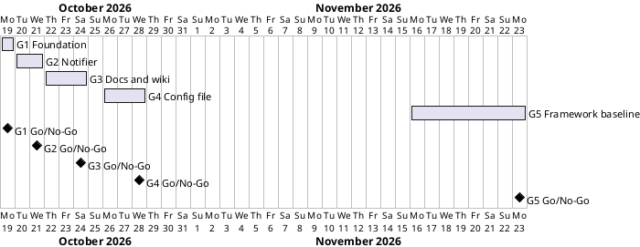

# Project Plan

## Metadata
| Key | Value |
| --- | --- |
| ID | PP-001 |
| CrossReference | [BC-001], [SA-001], [MIL-001], [MIL-002], [MIL-003], [MIL-004], [MIL-005] |
| Language | en |
| Domain | education |

## Version History
| Date | Status | Author | Reviewer | Change | Commit |
| --- | --- | --- | --- | --- | --- |
| 2026-10-26 | Deprecated | Jens Tirsvad Nielsen | S01 (AI as stand-in) | Added gateway G4 Config file | [f2afaf8] |
| 2026-10-27 | Deprecated | Jens Tirsvad Nielsen | S01 (AI as stand-in) | Open Issues: IP position guess added to G4 | [c6b02ef] |
| 2026-11-16 | Accepted | Jens Tirsvad Nielsen | S01 (AI as stand-in) | Added the baseline gateway G5 (MIL-005) with its schedule row, scope coverage, dependency, risk and Gantt entries; linked G1 to G4 to their milestones on the git host; corrected the purpose, the planning window, the G4 deliverable and the open issues; set the domain to education; reviewed in autonomous mode, not independent | [098f63a] |

---

## Purpose

This plan schedules the phases (gateways) that deliver the ISS Overhead Notifier ([BC-001]) in the order of the plan-first gate: repository foundation, the notifier itself, then the README, wiki and screenshots. The constraint is the Business Case's small-script scope: about 3 to 5 hours in total, one branch and one pull request per milestone. Gateways G4 and G5 were added later; see the Planning Assumptions.

## Planning Assumptions

- The plan starts on 2026-10-19. The Business Case sets no end date, only the effort estimate (about 3 to 5 hours) and one pull request per milestone. G1 to G3 end on 2026-10-24; G4 (the config file, added at S01's request) ends on 2026-10-28; G5 is the baseline milestone.
- The baseline gateway G5 ([MIL-005]) starts 2026-11-16 and ends 2026-11-23, one week. It brings the finished project to the baseline of the framework (decision of S01); the first four gateways keep their dates.
- Phase length: one to three working days; milestones run in series because each needs the code or the layout of the one before.
- S01 owns every phase and reviews it; in autonomous mode the AI is stand-in for S01 and every review record says so ([SA-001]).
- S02 and S03 are served by the third phase; they are not consulted ([BC-001] Assumptions).

## Gateway Schedule

| Gateway | Document | Window | Decision date | Owner | Stories | Main deliverable | Milestone |
| --- | --- | --- | --- | --- | --- | --- | --- |
| G1 Foundation | [MIL-001] | 2026-10-19 to 2026-10-19 | 2026-10-19 | S01 | none (plain tasks) | `pyproject.toml`, `.gitignore`, `.venv` instructions, `Doxyfile`, package skeleton with `constants.py`, repository description and topics | [Milestone 195][M-195] |
| G2 Notifier | [MIL-002] | 2026-10-20 to 2026-10-21 | 2026-10-21 | S01 | none (plain tasks) | Tested `is_iss_overhead`, `is_night`, mail sender and 60-second loop | [Milestone 196][M-196] |
| G3 Docs and wiki | [MIL-003] | 2026-10-22 to 2026-10-24 | 2026-10-24 | S01 | none (plain tasks) | README, screenshots, wiki in en, da and ms | [Milestone 197][M-197] |
| G4 Config file | [MIL-004] | 2026-10-26 to 2026-10-28 | 2026-10-28 | S01 | none (plain tasks) | `config.env` reader, `config.env.example`, position guess from the IP address, User-Agent header, updated README, wiki and screenshot | [Milestone 202][M-202] |
| G5 Framework baseline | [MIL-005] | 2026-11-16 to 2026-11-23 | 2026-11-23 | S01 | none (plain tasks) | The adopted framework release, the wiki pages and sidebar in the framework's shape, the README, licence metadata, the traceability matrix and review records | [Milestone 547][M-547] |



## Scope Coverage

| Business Case scope item | Gateway |
| --- | --- |
| `pyproject.toml`, `.gitignore`, `constants.py`, `Doxyfile` | [MIL-001] |
| Repository description and topics | [MIL-001] |
| Python 3.13 program under `src/`, Doxygen comments | [MIL-002] |
| Tests under `tests/` | [MIL-002] |
| Environment-variable configuration, no secrets | [MIL-002] |
| `.venv` instructions | [MIL-001], [MIL-003] |
| Settings in a `config.env` file (added after G3 at S01's request) | [MIL-004] |
| README from the framework template, wiki in en, da, ms, screenshots | [MIL-003] |
| The baseline: framework release, wiki shape, README, licence metadata, traceability matrix, review records | [MIL-005] |

## Dependencies

```
G1 Foundation → G2 Notifier → G3 Docs and wiki → G4 Config file → G5 Framework baseline
```

A No-Go at a gateway moves every later date by the rework time; the later gateways are not started. S01 decides the new dates. A No-Go on G5 ([MIL-005]) leaves the program and the earlier gateways as they are.

## Plan Risks

| Risk | Impact | Mitigation |
| --- | --- | --- |
| The sunrise-sunset or ISS API is down while screenshots are taken | G3 slips | Take screenshots from a run with recorded responses and say so in the wiki |
| The git host token lacks permission to set description and topics | G1 task cannot finish | Stop and report; S01 sets them by hand from the text in the task |
| Wiki publishing needs a workflow that the host may not support | Wiki stays in the repository only | Keep pages in `docs/wiki/`; publishing is optional per `framework/process/wiki.md` |
| A continuous integration (CI) check fails on the pull request of [MIL-005] | The merge is delayed past 2026-11-23 | The failure is fixed on the same branch and the checks run again; after three failed rounds on one cause the work stops and S01 decides (trace: success criterion SC9 of [BC-001]) |

## Open Issues

- Repository path: the request names `git.tirsystem.com/Tirsvad-Udemy-100_days_of_code`, but `origin` is `Tirsvad-Udemy-100-days-of-code/033-iss-location`. The plan uses `origin`. The description and the topics are set on `origin` (checked on the git host on 2026-11-16).
- "Python greater than 3.13" is read as 3.13 or newer.
- No task uses a use case or user story: the work follows the assignment text and each task cites a Business Case objective.
- G4 also adds a position guess from the public IP address (a third-party service, `get.geojs.io`). The Business Case does not list it as in or out of scope; S01 asked for it in chat on 2026-10-27 and it is recorded here and in [MIL-004] instead of amending [BC-001].
- The plan was accepted without a QC checklist until [MIL-005]; since then it is reviewed against `QC-PP-001` ([RC-017]).
- Domain: since [MIL-005] the plan, the Business Case, the Traceability Matrix and the baseline milestone have the domain `education`. The other documents (Stakeholder Analysis, Domain Dictionary, milestones MIL-001 to MIL-004 and the review records RC-001 to RC-015) keep the domain `it` they were accepted with; they are not changed by the baseline, and a change of their domain would need a new review of each.

---

[BC-001]: ./business-case.md
[SA-001]: ./stakeholder-analysis.md
[MIL-001]: ./milestones/mil-001-foundation.md
[MIL-002]: ./milestones/mil-002-notifier.md
[MIL-003]: ./milestones/mil-003-docs-wiki.md
[MIL-004]: ./milestones/mil-004-config-file.md
[f2afaf8]: https://git.tirsystem.com/Tirsvad-Udemy-100-days-of-code/033-iss-location/commit/f2afaf8f9d93fa95691f273b3fd3a658804eddee
[c6b02ef]: https://git.tirsystem.com/Tirsvad-Udemy-100-days-of-code/033-iss-location/commit/c6b02ef5942d486bc8f5a86a4a733d3ba76c1dc5
[M-195]: https://git.tirsystem.com/Tirsvad-Udemy-100-days-of-code/033-iss-location/milestones/195
[M-196]: https://git.tirsystem.com/Tirsvad-Udemy-100-days-of-code/033-iss-location/milestones/196
[M-197]: https://git.tirsystem.com/Tirsvad-Udemy-100-days-of-code/033-iss-location/milestones/197
[M-202]: https://git.tirsystem.com/Tirsvad-Udemy-100-days-of-code/033-iss-location/milestones/202
[MIL-005]: ./milestones/mil-005-framework-baseline.md
[RC-017]: ./sqa/reviews/rc-017-project-plan-baseline.md
[M-547]: https://git.tirsystem.com/Tirsvad-Udemy-100-days-of-code/033-iss-location/milestones/547
[098f63a]: https://git.tirsystem.com/Tirsvad-Udemy-100-days-of-code/033-iss-location/commit/098f63ab2539f469a56163d3a3c85bbaac7dbc84
