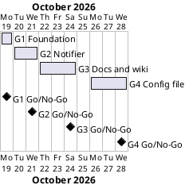

# Project Plan

## Metadata
| Key | Value |
| --- | --- |
| ID | PP-001 |
| CrossReference | [BC-001], [SA-001], [MIL-001], [MIL-002], [MIL-003], [MIL-004] |
| Language | en |
| Domain | it |

## Version History
| Date | Status | Author | Reviewer | Change | Commit |
| --- | --- | --- | --- | --- | --- |
| 2026-10-18 | Deprecated | Jens Tirsvad Nielsen | S01 (AI as stand-in) | Initial version | [cd21a73] |
| 2026-10-26 | Accepted | Jens Tirsvad Nielsen | S01 (AI as stand-in) | Added gateway G4 Config file | [f2afaf8] |

---

## Purpose

This plan schedules the three phases that deliver the ISS Overhead Notifier ([BC-001]) in the order of the plan-first gate: repository foundation, the notifier itself, then the README, wiki and screenshots. The constraint is the Business Case's small-script scope: about 3 to 5 hours in total, one branch and one pull request per milestone.

## Planning Assumptions

- The plan starts on 2026-10-19 and ends by 2026-10-24.
- Phase length: one to three working days; milestones run in series because each needs the code or the layout of the one before.
- S01 owns every phase and reviews it; in autonomous mode the AI is stand-in for S01 and every review record says so ([SA-001]).
- S02 and S03 are served by the third phase; they are not consulted ([BC-001] Assumptions).

## Gateway Schedule

| Gateway | Document | Window | Decision date | Owner | Stories | Main deliverable | Milestone |
| --- | --- | --- | --- | --- | --- | --- | --- |
| G1 Foundation | [MIL-001] | 2026-10-19 to 2026-10-19 | 2026-10-19 | S01 | none (plain tasks) | `pyproject.toml`, `.gitignore`, `.venv` instructions, `Doxyfile`, package skeleton with `constants.py`, repository description and topics | |
| G2 Notifier | [MIL-002] | 2026-10-20 to 2026-10-21 | 2026-10-21 | S01 | none (plain tasks) | Tested `is_iss_overhead`, `is_night`, mail sender and 60-second loop | |
| G3 Docs and wiki | [MIL-003] | 2026-10-22 to 2026-10-24 | 2026-10-24 | S01 | none (plain tasks) | README, screenshots, wiki in en, da and ms | |
| G4 Config file | [MIL-004] | 2026-10-26 to 2026-10-28 | 2026-10-28 | S01 | none (plain tasks) | `config.env` reader, `config.env.example`, updated README, wiki and screenshot | |



## Scope Coverage

| Business Case scope item | Gateway |
| --- | --- |
| `pyproject.toml`, `.gitignore`, `constants.py`, `Doxyfile` | [MIL-001] |
| Repository description and topics | [MIL-001] |
| Python 3.13 program under `src/`, Doxygen comments | [MIL-002] |
| Tests under `tests/` | [MIL-002] |
| Environment-variable configuration, no secrets | [MIL-002] |
| `.venv` instructions | [MIL-001], [MIL-003] |
| Settings in a `config.env` file (added after G3 at S01's request) | [MIL-004] |
| README from the framework template, wiki in en, da, ms, screenshots | [MIL-003] |

## Dependencies

```
G1 Foundation → G2 Notifier → G3 Docs and wiki → G4 Config file
```

A No-Go at a gateway moves every later date by the rework time; the later gateways are not started.

## Plan Risks

| Risk | Impact | Mitigation |
| --- | --- | --- |
| The sunrise-sunset or ISS API is down while screenshots are taken | G3 slips | Take screenshots from a run with recorded responses and say so in the wiki |
| The git host token lacks permission to set description and topics | G1 task cannot finish | Stop and report; S01 sets them by hand from the text in the task |
| Wiki publishing needs a workflow that the host may not support | Wiki stays in the repository only | Keep pages in `docs/wiki/`; publishing is optional per `framework/process/wiki.md` |

## Open Issues

- Repository path: the request names `git.tirsystem.com/Tirsvad-Udemy-100_days_of_code`, but `origin` is `Tirsvad-Udemy-100-days-of-code/033-iss-location`. The plan uses `origin`. Confirm before the description and topics are set.
- "Python greater than 3.13" is read as 3.13 or newer.
- No task uses a use case or user story: the work follows the assignment text and each task cites a Business Case objective.
- No QC checklist exists for the Project Plan; it is accepted against the Business Case constraint and the Go/No-Go criteria of each milestone.

---

[BC-001]: ./business-case.md
[SA-001]: ./stakeholder-analysis.md
[MIL-001]: ./milestones/mil-001-foundation.md
[MIL-002]: ./milestones/mil-002-notifier.md
[MIL-003]: ./milestones/mil-003-docs-wiki.md
[MIL-004]: ./milestones/mil-004-config-file.md
[cd21a73]: https://git.tirsystem.com/Tirsvad-Udemy-100-days-of-code/033-iss-location/commit/cd21a7366b9c25f09a6ff9c7283f82f8f865d6e5
[f2afaf8]: https://git.tirsystem.com/Tirsvad-Udemy-100-days-of-code/033-iss-location/commit/f2afaf8f9d93fa95691f273b3fd3a658804eddee
